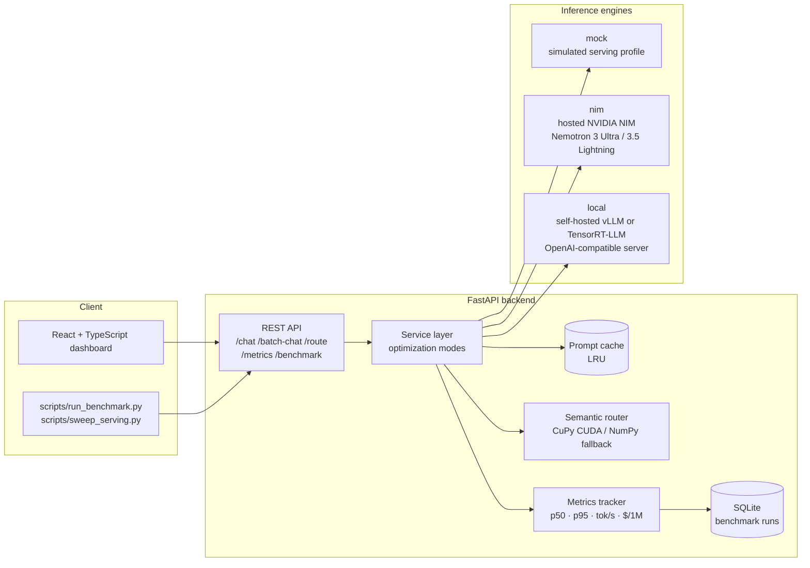
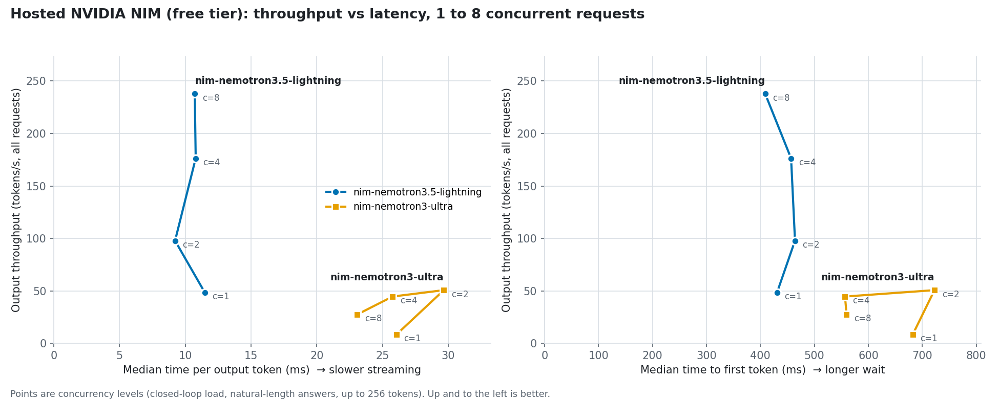
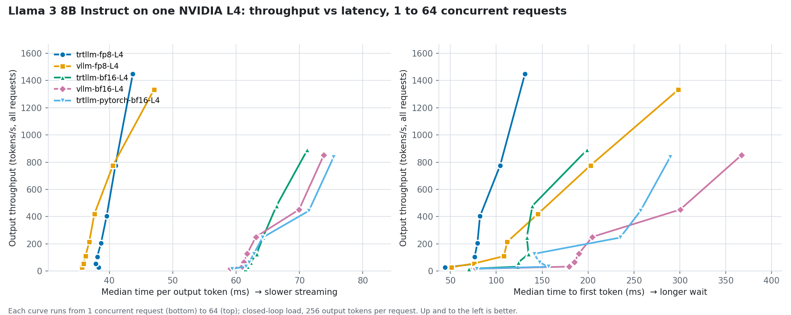

# InferEdge: GPU-Optimized LLM Inference Platform for Real-Time AI Agents

InferEdge is a full-stack platform for **benchmarking LLM inference optimization strategies** behind a real-time customer-support AI agent. It serves support prompts through five serving strategies — baseline, continuous batching, prompt caching, CUDA-accelerated semantic routing, and a quantization placeholder, and measures what actually matters in production inference: **time-to-first-token, p50/p95 latency, tokens/sec, requests/sec, and cost per 1M tokens**.

It runs entirely locally in **mock mode** (no GPU, no API key), and flips to real **NVIDIA NIM / Nemotron** inference with one environment variable.

## Read this first: where the numbers come from

InferEdge is a **benchmarking harness**, and its numbers come from three sources:

- **Simulated serving profile (mock mode).** Each model tier has a time-to-first-token and a per-token decode rate modeled on 8B-class and 70B-class GPU serving. That let me compare optimization strategies cheaply and reproducibly, with no GPU bill and no rate limits. The *ratios* between strategies are the point; the absolute milliseconds are the simulator's assumptions, not measurements of real hardware.
- **Real hosted inference (NIM mode), measured.** The same harness runs unchanged against NVIDIA's hosted NIM endpoints: Nemotron 3 Ultra for the large tier and Nemotron 3.5 Lightning for the small tier. Responses are streamed, so time-to-first-token is measured from the first content chunk rather than estimated. See [Real results: hosted NVIDIA NIM](#real-results-hosted-nvidia-nim) and [What changed vs. the simulator](#what-changed-vs-the-simulator).
- **Self-hosted GPU, measured.** Llama 3 8B Instruct served by vLLM and TensorRT-LLM on one cloud NVIDIA L4, in bf16 and FP8, across 1 to 64 concurrent requests. See [Real results: self-hosted on an NVIDIA L4](#real-results-self-hosted-on-an-nvidia-l4).
- **Routing strategies, measured and graded.** InferEdge's router vs. NVIDIA NeMo Switchyard's random and LLM-classifier routing on real NIM models, with every answer graded blind. See [Routing strategies compared](#routing-strategies-compared-nvidia-nemo-switchyard).

Two more things to know when reading the results:

- **Costs are estimates.** They use assumed per-token list prices (see `MODEL_TIERS` in `backend/app/config.py`). The free build.nvidia.com tier charges nothing.
- **Some paths are not exercised on every machine.** `quantized` is simulator-only, and the API refuses it in NIM mode because hosted NIM has no quantization toggle. The router's CUDA path (CuPy) needs an NVIDIA GPU; on a machine without one, the router benchmark reports CPU fallback timings only. The router's GPU numbers below were measured on a cloud NVIDIA L4.

## Architecture



**Request flow:** a prompt hits `/chat` with an optimization mode → the service layer consults the prompt cache and/or semantic router → the router classifies intent on GPU (CuPy/cuBLAS) or CPU (NumPy fallback) and picks a model tier (small or large) → the selected engine generates → every request is logged with full latency/token/cost metrics.

The `nim` and `local` engines share one streaming client (`backend/app/inference/openai_compat.py`), and so does the serving sweep, so hosted and self-hosted numbers are measured by the same code.

## Optimization modes benchmarked

| Mode | What it does | Simulated result | Measured on hosted NIM |
|---|---|---|---|
| `baseline` | Sequential single requests to the large model | The control group | The control group |
| `batching` | Requests sent concurrently in batches of 8 | 5.4x throughput | 2.8x throughput |
| `caching` | Exact-match LRU cache in front of the engine | 76% hits, 76% cheaper | 76% hits, 75% cheaper |
| `routing` | Semantic router sends easy intents to a small model | 2.8x faster p50, 61% cheaper | 4.5x faster p50, 56% cheaper |
| `quantized` | Simulated INT8/FP8 serving profile | 1.5x faster p50 | Not applicable (simulator only) |

Simulated serving profile (mock mode), 50 prompts (`scripts/run_benchmark.py`):

```
mode        reqs  wall(s)   req/s  p50(ms)  p95(ms)  ttft(ms)    tok/s    $/1M tok  cache
baseline      50    29.61    1.69   580.01   668.24     85.74   133.80     1.2644      -
batching      50     5.49    9.11   706.48   826.60     86.40   110.72     1.2644      -
caching       50     7.32    6.83     0.05   648.67     21.50   127.52     0.3076    76%
routing       50    15.28    3.27   209.70   665.63     46.19   328.65     0.4939      -
quantized     50    18.98    2.63   383.10   432.00     58.86   209.52     1.2644      -
```

## Real results: hosted NVIDIA NIM

Measured on October 22, 2026 against the free tier of [build.nvidia.com](https://build.nvidia.com), with the same 50 customer-support prompts, streamed responses, and model "thinking" disabled (see below).

- **Large tier:** `nvidia/nemotron-3-ultra-550b-a55b`, a mixture-of-experts model with 550B parameters, about 55B active per token.
- **Small tier:** `nvidia/nemotron-3.5-lightning-30b-a3b`, 30B parameters, about 3B active per token.

| Mode | Req/s | p50 latency (ms) | p95 latency (ms) | Avg TTFT (ms) | Output tok/s | $/1M tokens | Cache hit rate |
|---|---:|---:|---:|---:|---:|---:|---:|
| baseline | 0.18 | 4147 | 15672 | 1428 | 26 | 1.043 | — |
| batching | 0.50 | 3313 | 18483 | 1051 | 28 | 1.042 | — |
| caching | 0.77 | 0 (cache hits) | 7480 | 204 | 33 | 0.259 | 76% |
| routing | 0.34 | 917 | 8827 | 932 | 50 | 0.455 | — |

**Throughput vs. latency under load.** `scripts/sweep_serving.py` sent 1, 2, 4 and 8 concurrent requests to each model:



| Model | Concurrency | Output tok/s | TTFT p50 / p95 (ms) | Time per output token p50 (ms) | Errors |
|---|---:|---:|---:|---:|---:|
| Nemotron 3.5 Lightning | 1 | 48 | 431 / 500 | 11.5 | 0 |
| | 2 | 98 | 464 / 618 | 9.2 | 0 |
| | 4 | 176 | 457 / 581 | 10.8 | 0 |
| | 8 | 238 | 409 / 557 | 10.7 | 5 of 16 (HTTP 429) |
| Nemotron 3 Ultra | 1 | 8 | 682 / 31686 | 26.1 | 0 |
| | 2 | 51 | 722 / 1386 | 29.7 | 0 |
| | 4 | 45 | 557 / 5028 | 25.8 | 0 |
| | 8 | 28 | 560 / 22800 | 23.1 | 1 of 16 (empty reply) |

Lightning scales almost linearly: going from 1 to 8 concurrent requests gave 4.9x the throughput while median time to first token stayed between 0.41 and 0.46 seconds. Ultra did not scale at all. Its throughput peaked at 2 concurrent requests, and its tail latency was dominated by queueing spikes of up to 31 seconds before the first token. Ultra's 8 tok/s at concurrency 1 is not its decode speed (its time per token was about 26 ms, roughly 38 tok/s per stream); one 31-second wait inflated that level's wall-clock time.

Raw results: [`benchmark_results/nim/`](benchmark_results/nim/).

## Real results: self-hosted on an NVIDIA L4

Measured on October 23, 2026: `NousResearch/Meta-Llama-3-8B-Instruct` on one NVIDIA L4 (24 GB), served by vLLM 0.21.0 and TensorRT-LLM 1.2.1, and measured by `scripts/sweep_serving.py` running on the same machine, so network latency stays out of the numbers. Each sweep runs 1 to 64 concurrent requests of exactly 256 output tokens. "1 user" means concurrency 1, and "64 users" means concurrency 64.



| Engine | Precision | 1 user: ms per token | 1 user: TTFT (ms) | 64 users: total tok/s | 64 users: TTFT p50 (ms) | 64 users: ITL p99 (ms) | KV cache (tokens) |
|---|---|---:|---:|---:|---:|---:|---:|
| TensorRT-LLM engine | FP8 (weights + KV cache) | 38.3 | 44 | 1,448 | 131 | 48 | 170,176 |
| vLLM | FP8 (weights + KV cache) | 35.8 | 53 | 1,394 | 283 | 139 | 155,936 |
| vLLM | FP8 (weights) | 35.7 | 51 | 1,332 | 298 | 150 | 81,008 |
| TensorRT-LLM engine | bf16 | 61.5 | 70 | 889 | 199 | 223 | 39,552 |
| vLLM | bf16 | 59.1 | 78 | 851 | 367 | 228 | 34,384 |
| TensorRT-LLM PyTorch backend | bf16 | 59.4 | 78 | 837 | 289 | 236 | 39,424 |

- **Batching is nearly free throughput.** In bf16, going from 1 to 64 concurrent users multiplied vLLM's throughput 50x (17 → 851 tok/s) while one user's time per token only rose from 59 to 74 ms. Decoding is limited by reading the 15 GB of weights from memory, and a batch shares each read.
- **FP8 is the biggest lever.** It nearly halves the bytes read per token, so one user's text streams about 1.6x faster and peak throughput rises 56–63%. It also frees memory for KV cache, so more conversations fit at once.
- **TensorRT-LLM wins under load; vLLM wins one user at a time.** With a single user vLLM was 2–3 ms per token faster. At 64 users the TensorRT-LLM FP8 engine gave 9% more throughput, less than half the time to first token (131 vs 298 ms), and much steadier streaming (worst 1% of token gaps 48 vs 150 ms). Giving vLLM an FP8 KV cache too nearly doubled its cache (81k → 156k tokens) but barely moved its latency, so TensorRT-LLM's edge comes from its scheduler and kernels, not its cache format.
- **Self-hosted vs. hosted:** the slowest 5% of first-token waits on the shared NIM free tier reached 31 seconds; on a dedicated L4 at 64 concurrent users, p95 time to first token stayed under 0.5 seconds for every engine.

**Going further on the same GPU** (details in [docs/TENSORRT_LLM.md](docs/TENSORRT_LLM.md)):

- **Speculative decoding:** a Llama 3.2 1B draft model made one user's text stream 1.4x faster (59 → 41 ms per token) with identical output. On a 24 GB card, though, the second model leaves room for only a third of the KV cache, so beyond about 8 concurrent users requests queue (21 s first-token waits at 64). N-gram speculation was slower than none for support answers (0.96x at one user, 0.47x at 64).
- **Batching limits:** rebuilding the FP8 engine for up to 256 concurrent requests doubled peak throughput to 2,928 tok/s. The knee is around 128 users (2,331 tok/s, first-token p95 under 0.4 s); past it, each user's stream slows to about 12 tokens/s.

Details, failures and what I learned integrating TensorRT-LLM: [docs/TENSORRT_LLM.md](docs/TENSORRT_LLM.md). Reproduce: [docs/SELF_HOSTED.md](docs/SELF_HOSTED.md). Raw results: [`benchmark_results/gpu/`](benchmark_results/gpu/).

## What changed vs. the simulator

1. **Tail latency is the real story.** In the simulator, p95 latency stayed within 1.2x of p50. On the shared free tier, baseline p95 was 3.8x p50, and Ultra had first-token waits of up to 31 seconds while its median stayed under 0.75 seconds. Averages hide this, which is why InferEdge reports p95 everywhere. It is also the strongest argument for dedicated or self-hosted capacity in a real-time agent.
2. **Routing paid off more than simulated.** The simulator predicted a 2.8x faster median; real routing was 4.5x faster, because the gap between the real tiers (about 3B vs. 55B active parameters) is wider than the simulated 8B vs. 70B profile. Cost savings were similar: 56% real vs. 61% simulated.
3. **Batching paid off less than simulated.** The simulator showed 5.4x throughput; real batching gave 2.8x. Against a hosted endpoint, "batching" is only client-side concurrency (capped at 4 in-flight requests to respect the free tier). The server's own batching and per-key rate limits decide the rest, and at 8 concurrent requests the free tier started returning HTTP 429.
4. **Caching matched.** Same traffic shape, same 76% hit rate, and a 75% cost reduction (the simulator gave 76%).
5. **Reasoning models need to be told not to reason.** Nemotron 3.x thinks before answering by default. With a 256-token budget, Lightning spent every token reasoning and returned no answer, and Ultra's first visible token took 1.1 seconds instead of 0.36. NIM requests now send `enable_thinking: false` (`NIM_DISABLE_THINKING`).
6. **The hosted catalog is not a guarantee.** Llama 3.1 Nemotron 70B and Mistral-NeMo-Minitron 8B are still listed at `/v1/models` but return 404 for new keys. Probing each model before benchmarking caught this.

## Routing strategies compared: NVIDIA NeMo Switchyard

I put [NeMo Switchyard](https://github.com/NVIDIA-NeMo/Switchyard), NVIDIA's open-source LLM routing proxy, in front of the same two NIM models and ran the 50 prompts through its random and LLM-classifier routing, next to InferEdge's own router and both single-model baselines. A model that isn't one of the two candidates (`gpt-oss-20b`) graded every answer blind, 1 to 5.

| Strategy | Weak-model share | Quality (1-5) | Quality, hard requests | Good or better | TTFT p50 (ms) | TTFT p95 (ms) | Cost incl. judge ($) | vs always-Ultra |
|---|---:|---:|---:|---:|---:|---:|---:|---:|
| always-ultra | 0% | 3.78 | 3.8 | 66% | 660 | 2707 | 0.00739 | +0% |
| always-lightning | 100% | 3.66 | 3.8 | 70% | 233 | 308 | 0.00086 | -88% |
| inferedge-semantic | 74% | 3.68 | 4.2 | 70% | 247 | 1636 | 0.00257 | -65% |
| sy-classifier | 16% | 3.92 | 4.3 | 74% | 3874 | 7577 | 0.01115 | +51% |
| sy-random | 48% | 3.88 | 3.7 | 72% | 356 | 2079 | 0.00483 | -35% |
| sy-random-matched | 18% | 3.72 | 3.7 | 64% | 396 | 10529 | 0.00649 | -12% |

- **Quality was a statistical tie.** On these short support turns, none of the strategies differed from always-Ultra beyond the noise (paired 95% bootstrap intervals all include zero). Even the small model alone matched it.
- **So cost and latency decide, and there the gaps are large.** InferEdge's router was 65% cheaper than always-Ultra with no routing delay. Switchyard's LLM classifier was 51% *more* expensive and added about 3 seconds before the first token. Each judge verdict read about 1,125 tokens, roughly 8x an average answer, and the judge sent 84% of requests to the big model anyway.
- **LLM-judge routing pays off when the judge is cheap relative to the work it routes**, like long agentic or coding tasks. For real-time support turns, a millisecond embedding router (or simply the small model) is the better trade.

Setup, method, caveats and how to reproduce: [docs/SWITCHYARD.md](docs/SWITCHYARD.md).

## Quickstart (mock mode — no GPU, no API key)

### Backend

```bash
cd backend
python3 -m venv .venv
.venv/bin/pip install -r requirements.txt
.venv/bin/uvicorn app.main:app --port 8000        # http://localhost:8000/docs
```

### Dashboard (requires Node 18+)

The React + TypeScript dashboard has four views:

- **Assistant:** a multi-turn support chatbot. Each answer shows which model handled it, its time to first token, latency and cost, and **Show calculation** walks through how those numbers were derived: the router's similarity scores and decision, token counts, the cost formula with the tier's prices, tokens per second, and the saving versus always using the large model. Conversations persist in the browser.
- **Router:** classifies a message as you type, with similarity bars, the chosen tier, and a low-confidence warning when the embeddings can't tell intents apart.
- **Benchmarks:** runs the optimization benchmark against the current backend and compares strategies in an interactive chart and table.
- **Results:** interactive charts of every measured result: self-hosted L4 sweeps (engines, speculative decoding, batching limits), hosted NIM, the Switchyard routing study, and router accuracy and GPU latency. Hover any point for its numbers; toggle series; switch the x-axis between time per token and time to first token.

Light and dark themes, keyboard navigation, and layouts down to phone width. The chart-heavy views load on demand, so the assistant opens fast.

```bash
cd frontend
npm install
npm run dev                                        # http://localhost:5173
```

### Benchmark CLI

```bash
# with the backend running:
backend/.venv/bin/python scripts/run_benchmark.py --num-prompts 50
# results land in benchmark_results/*.json, *.csv and *.md
```

### Tests

```bash
cd backend && .venv/bin/python -m pytest tests/ -v
```

### Docker (backend + dashboard in one command)

```bash
docker compose up --build
# dashboard: http://localhost:3000   API: http://localhost:8000/docs
```

## Using real NVIDIA NIM / Nemotron inference

1. Get a free API key at [build.nvidia.com](https://build.nvidia.com).
2. `cp .env.example .env` and set the values below in `.env`, never in `.env.example`, which is tracked by git. The backend reads `.env` on startup, and real environment variables take precedence.

```bash
INFERENCE_MODE=nim
NVIDIA_API_KEY=nvapi-...
NVIDIA_NIM_MODEL=nvidia/nemotron-3-ultra-550b-a55b
NVIDIA_NIM_SMALL_MODEL=nvidia/nemotron-3.5-lightning-30b-a3b
```

3. Restart the backend and run the benchmark (`quantized` is skipped automatically in NIM mode):

```bash
backend/.venv/bin/python scripts/run_benchmark.py --num-prompts 50
```

4. Optionally, sweep one model across concurrency levels:

```bash
SWEEP_API_KEY=nvapi-... backend/.venv/bin/python scripts/sweep_serving.py \
  --base-url https://integrate.api.nvidia.com/v1 --model nvidia/nemotron-3.5-lightning-30b-a3b \
  --label nim-lightning --levels 1 2 4 8 --out-dir benchmark_results/nim \
  --extra-body '{"chat_template_kwargs": {"enable_thinking": false}}'
```

Routed small-tier traffic goes to Nemotron 3.5 Lightning; everything else goes to Nemotron 3 Ultra. The metrics, benchmarks, and dashboard work unchanged. The NIM client is built for the free tier's rate limits: it caps in-flight requests (`NIM_MAX_CONCURRENCY`, default 4) and retries 429/5xx responses with exponential backoff.

## The CUDA semantic router

`backend/app/routing/semantic_router.py` classifies prompts into six support intents (billing, technical_support, account_management, refund, shipping, human_escalation) and maps each to a model tier.

- **Embeddings:** by default, deterministic hashed random-projection vectors (384-dim), a dependency-free stand-in that matches words rather than meaning. Set `ROUTER_EMBEDDINGS=minilm` to use the `all-MiniLM-L6-v2` sentence encoder instead (needs `sentence-transformers`); on a GPU, embedding and scoring then both stay on the device.
- **Scoring:** cosine similarity against category centroids — dense matmuls that run as **cuBLAS kernels via CuPy** on an NVIDIA GPU, with an automatic **NumPy CPU fallback** ("CPU fallback mode") when no GPU is present.
- **CPU vs GPU benchmark:** `POST /router/benchmark` scores thousands of intents on both backends (with warm-up and explicit `cudaStreamSynchronize` so timings are honest) and reports the speedup. The dashboard has a one-click button for it.

```bash
# on a GPU machine:
pip install cupy-cuda12x   # router switches to CUDA automatically
```

### Measured on an NVIDIA L4

`gpu/modal_router.py` runs the router's scoring code on an NVIDIA L4 (CuPy) and on the same machine's 17-core CPU (NumPy). Each size is the median of 7 runs, and the GPU must pick the same category as the CPU for every intent before any timing counts.

| Intents | CPU NumPy (ms) | GPU compute only (ms) | GPU incl. transfers (ms) | Speedup, compute only | Speedup, incl. transfers |
|---:|---:|---:|---:|---:|---:|
| 1 | 0.003 | 0.122 | 0.258 | 0.02x | 0.01x |
| 100 | 0.011 | 0.095 | 0.271 | 0.11x | 0.04x |
| 1,000 | 0.272 | 0.095 | 0.572 | 2.86x | 0.48x |
| 10,000 | 2.843 | 0.099 | 4.171 | 28.87x | 0.68x |
| 100,000 | 35.266 | 0.896 | 42.035 | 39.36x | 0.84x |
| 1,000,000 | 431.560 | 8.835 | 354.940 | 48.85x | 1.22x |

What this shows:

- **The GPU's math is up to 49x faster**, and it wins from about 1,000 intents up.
- **Moving the data erases most of that win.** Each intent sends 384 numbers to the GPU for only 6 dot products, so copying data over PCIe costs more than the arithmetic saves. Including transfers, the GPU only pulls ahead at around 1 million intents (1.22x).
- **For one live request, the CPU is about 40x faster** (0.003 ms vs 0.12 ms), because launching GPU work has a fixed cost.
- **The fix is to keep data on the GPU,** which the next measurement does.

Raw results: [`benchmark_results/gpu/router_L4.json`](benchmark_results/gpu/router_L4.json).

### Real embeddings on the GPU (MiniLM)

`gpu/modal_router_embed.py` swaps the hashed embeddings for `all-MiniLM-L6-v2` and measures two things: accuracy on 60 held-out labeled support messages (`backend/app/router_eval_set.py`, none of them seen by the router, many phrased without the obvious keyword), and end-to-end routing time from text in to category out. Every path must return identical categories before any timing counts.

Held-out accuracy (60 labeled support messages):

| Embeddings | Category accuracy | Model-tier accuracy |
|---|---:|---:|
| Hashed words (default) | 42% | 67% |
| all-MiniLM-L6-v2 | 93% | 100% |

End-to-end routing latency, text in to category out, on NVIDIA L4 vs 8 CPU cores (median of several runs):

| Messages | CPU (ms) | GPU, all on device (ms) | GPU embed, CPU score (ms) | Speedup | GPU messages/s |
|---:|---:|---:|---:|---:|---:|
| 1 | 10.6 | 7.1 | 7.1 | 1.5x | 140 |
| 10 | 17.7 | 8.9 | 8.6 | 2.0x | 1,122 |
| 100 | 75.6 | 13.8 | 13.8 | 5.5x | 7,262 |
| 1,000 | 703.0 | 72.7 | 74.1 | 9.7x | 13,757 |
| 10,000 | 5850.9 | 647.9 | 654.7 | 9.0x | 15,435 |

- **The default router was badly wrong on paraphrases:** 42% category accuracy. "The courier says delivered but nothing is at my door" doesn't share words with its shipping examples. MiniLM got 93% of categories right, and every one of its misses still picked the right model tier (100% tier accuracy).
- **With a real model to run, the GPU wins at every size, even one message** (7.1 vs 10.6 ms), and is 9–10x faster from 1,000 messages up, at about 15,000 messages per second. The earlier CuPy benchmark lost at small sizes because six dot products are too little work to be worth a trip to the GPU; a transformer forward pass is not.
- **Copying results back no longer matters:** embedding on the GPU and scoring on the CPU costs about the same as keeping everything on the device, because the transformer, not the transfer, now dominates.
- **The cost is about 10 ms per message on CPU instead of 0.4 ms** for hashed embeddings, which is still negligible next to an LLM call.

Raw results: [`benchmark_results/gpu/router_embed_L4.json`](benchmark_results/gpu/router_embed_L4.json).

## API surface

| Endpoint | Description |
|---|---|
| `POST /chat` | One prompt through a chosen mode (`baseline`, `caching`, `routing`, `quantized`) |
| `POST /batch-chat` | A list of prompts served as one concurrent batch |
| `POST /route` | Classify a prompt: category, confidence, per-category scores, model tier |
| `POST /router/benchmark` | CPU vs GPU similarity-scoring benchmark |
| `POST /benchmark/run` | Full benchmark across optimization modes (persisted to SQLite) |
| `GET /benchmark-results` | Saved benchmark runs |
| `GET /metrics` | Rolling p50/p95 latency, tokens/sec, req/s, cost/1M tokens, cache stats |
| `GET /sample-prompts` | The customer-support prompt suite |

Interactive docs at `/docs` (OpenAPI/Swagger).

## Where the production NVIDIA stack plugs in

The `local` engine (`backend/app/inference/local_engine.py`) talks to any self-hosted OpenAI-compatible server, so the rest of the platform needs no changes. `gpu/` contains Modal scripts that start these servers on a cloud NVIDIA L4 and measure them with the same sweep (see [docs/SELF_HOSTED.md](docs/SELF_HOSTED.md)):

- **vLLM** (`gpu/modal_vllm.py`): continuous batching and automatic prefix caching, the real versions of the `batching` and `caching` modes here, served in bf16 and dynamic FP8.
- **TensorRT-LLM** (`gpu/modal_trtllm.py`): ahead-of-time compiled engines in bf16 and calibrated FP8 (the real version of the `quantized` mode), plus the 1.x PyTorch backend with draft-model and n-gram speculative decoding, all served with `trtllm-serve` and measured above; see [docs/TENSORRT_LLM.md](docs/TENSORRT_LLM.md).
- **NVIDIA NeMo Switchyard** (`switchyard/nim_routes.toml`): an OpenAI-compatible routing proxy in front of the NIM models, measured above. Because InferEdge's `local` engine speaks the same API, the app can point at Switchyard too.
- **Triton Inference Server / NVIDIA Dynamo**: production serving with dynamic batching policies, multi-GPU scheduling, and KV-cache-aware routing, the production version of the semantic router's tiering decision.

## Project structure

```
backend/
  app/
    main.py               FastAPI app + endpoints
    service.py            optimization-mode orchestration
    benchmark.py          benchmark runner (traffic shapes per mode)
    metrics.py            rolling metrics tracker (p50/p95, tok/s, $/1M)
    db.py                 SQLite persistence for benchmark runs
    config.py             env config + model-tier pricing
    sample_prompts.py     customer-support prompt suite
    router_eval_set.py    60 held-out labeled messages for router accuracy
    inference/
      engine.py           engine abstraction + factory
      mock_engine.py      simulated serving profiles (default)
      openai_compat.py    shared streaming client: TTFT, per-token timing, retries
      nim_engine.py       hosted NVIDIA NIM (Nemotron) engine
      local_engine.py     self-hosted vLLM / TensorRT-LLM engine
      prompt_cache.py     LRU response cache
    routing/
      semantic_router.py  CUDA (CuPy) / CPU (NumPy) intent router
  tests/                  API, router, NIM client, local engine and sweep tests
frontend/                 React + TypeScript + Vite dashboard
gpu/                      Modal scripts: vLLM, TensorRT-LLM and router benchmarks on an NVIDIA L4
switchyard/               NeMo Switchyard routing config for the NIM models
scripts/
  run_benchmark.py        optimization-mode benchmark CLI (JSON/CSV/Markdown)
  sweep_serving.py        throughput vs latency across concurrency levels
  plot_sweep.py           throughput-vs-latency charts
  route_compare.py        routing strategies vs. Switchyard, with blind grading
benchmark_results/        measured results: nim/, gpu/, switchyard/
docs/                     TensorRT-LLM log, Switchyard study, self-hosting guide, charts
docker-compose.yml        backend + dashboard
```
