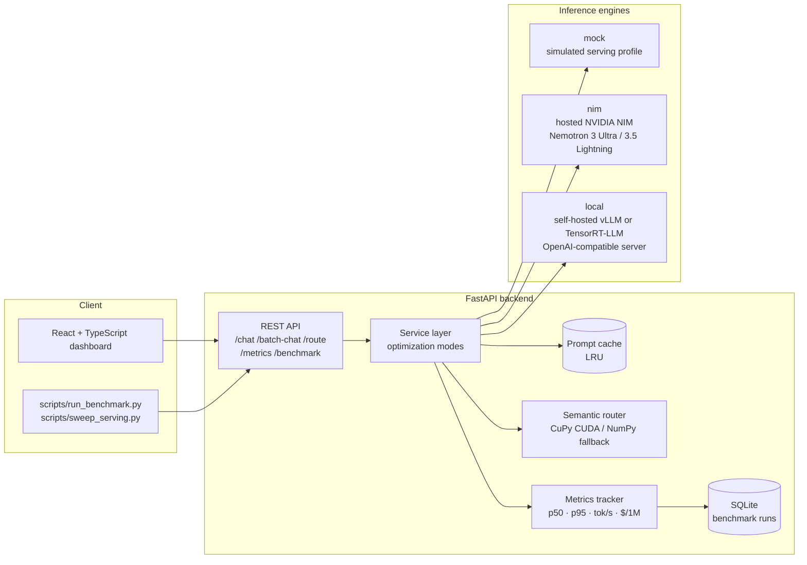

# InferEdge: GPU-Optimized LLM Inference Platform for Real-Time AI Agents

InferEdge is a full-stack platform for **benchmarking LLM inference optimization strategies** behind a real-time customer-support AI agent. It serves support prompts through five serving strategies — baseline, continuous batching, prompt caching, CUDA-accelerated semantic routing, and a quantization placeholder, and measures what actually matters in production inference: **time-to-first-token, p50/p95 latency, tokens/sec, requests/sec, and cost per 1M tokens**.

It runs entirely locally in **mock mode** (no GPU, no API key), and flips to real **NVIDIA NIM / Nemotron** inference with one environment variable.

## Read this first: where the numbers come from

InferEdge is a **benchmarking harness**, and its numbers come from three sources:

- **Simulated serving profile (mock mode).** Each model tier has a time-to-first-token and a per-token decode rate modeled on 8B-class and 70B-class GPU serving. That let me compare optimization strategies cheaply and reproducibly, with no GPU bill and no rate limits. The *ratios* between strategies are the point; the absolute milliseconds are the simulator's assumptions, not measurements of real hardware.
- **Real hosted inference (NIM mode), measured.** The same harness runs unchanged against NVIDIA's hosted NIM endpoints: Nemotron 3 Ultra for the large tier and Nemotron 3.5 Lightning for the small tier. Responses are streamed, so time-to-first-token is measured from the first content chunk rather than estimated. See [Real results: hosted NVIDIA NIM](#real-results-hosted-nvidia-nim) and [What changed vs. the simulator](#what-changed-vs-the-simulator).
- **Self-hosted GPU (vLLM and TensorRT-LLM on an NVIDIA L4).** The scripts are built and tested, and the GPU runs are next. See [docs/SELF_HOSTED.md](docs/SELF_HOSTED.md).

Two more things to know when reading the results:

- **Costs are estimates.** They use assumed per-token list prices (see `MODEL_TIERS` in `backend/app/config.py`). The free build.nvidia.com tier charges nothing.
- **Some paths are not exercised on every machine.** `quantized` is simulator-only, and the API refuses it in NIM mode because hosted NIM has no quantization toggle. The router's CUDA path (CuPy) needs an NVIDIA GPU; on a machine without one, the router benchmark reports CPU fallback timings only. The router's GPU numbers below were measured on a cloud NVIDIA L4.

## Architecture



**Request flow:** a prompt hits `/chat` with an optimization mode → the service layer consults the prompt cache and/or semantic router → the router classifies intent on GPU (CuPy/cuBLAS) or CPU (NumPy fallback) and picks a model tier (small or large) → the selected engine generates → every request is logged with full latency/token/cost metrics.

The `nim` and `local` engines share one streaming client (`backend/app/inference/openai_compat.py`), and so does the serving sweep, so hosted and self-hosted numbers are measured by the same code.

## Optimization modes benchmarked

| Mode | What it does | Simulated result | Measured on hosted NIM |
|---|---|---|---|
| `baseline` | Sequential single requests to the large model | The control group | The control group |
| `batching` | Requests sent concurrently in batches of 8 | 5.4x throughput | 2.8x throughput |
| `caching` | Exact-match LRU cache in front of the engine | 76% hits, 76% cheaper | 76% hits, 75% cheaper |
| `routing` | Semantic router sends easy intents to a small model | 2.8x faster p50, 61% cheaper | 4.5x faster p50, 56% cheaper |
| `quantized` | Simulated INT8/FP8 serving profile | 1.5x faster p50 | Not applicable (simulator only) |

Simulated serving profile (mock mode), 50 prompts (`scripts/run_benchmark.py`):

```
mode        reqs  wall(s)   req/s  p50(ms)  p95(ms)  ttft(ms)    tok/s    $/1M tok  cache
baseline      50    29.61    1.69   580.01   668.24     85.74   133.80     1.2644      -
batching      50     5.49    9.11   706.48   826.60     86.40   110.72     1.2644      -
caching       50     7.32    6.83     0.05   648.67     21.50   127.52     0.3076    76%
routing       50    15.28    3.27   209.70   665.63     46.19   328.65     0.4939      -
quantized     50    18.98    2.63   383.10   432.00     58.86   209.52     1.2644      -
```

## Real results: hosted NVIDIA NIM

Measured on October 22, 2026 against the free tier of [build.nvidia.com](https://build.nvidia.com), with the same 50 customer-support prompts, streamed responses, and model "thinking" disabled (see below).

- **Large tier:** `nvidia/nemotron-3-ultra-550b-a55b`, a mixture-of-experts model with 550B parameters, about 55B active per token.
- **Small tier:** `nvidia/nemotron-3.5-lightning-30b-a3b`, 30B parameters, about 3B active per token.

| Mode | Req/s | p50 latency (ms) | p95 latency (ms) | Avg TTFT (ms) | Output tok/s | $/1M tokens | Cache hit rate |
|---|---:|---:|---:|---:|---:|---:|---:|
| baseline | 0.18 | 4147 | 15672 | 1428 | 26 | 1.043 | — |
| batching | 0.50 | 3313 | 18483 | 1051 | 28 | 1.042 | — |
| caching | 0.77 | 0 (cache hits) | 7480 | 204 | 33 | 0.259 | 76% |
| routing | 0.34 | 917 | 8827 | 932 | 50 | 0.455 | — |

**Throughput vs. latency under load.** `scripts/sweep_serving.py` sent 1, 2, 4 and 8 concurrent requests to each model:


| Model | Concurrency | Output tok/s | TTFT p50 / p95 (ms) | Time per output token p50 (ms) | Errors |
|---|---:|---:|---:|---:|---:|
| Nemotron 3.5 Lightning | 1 | 48 | 431 / 500 | 11.5 | 0 |
| | 2 | 98 | 464 / 618 | 9.2 | 0 |
| | 4 | 176 | 457 / 581 | 10.8 | 0 |
| | 8 | 238 | 409 / 557 | 10.7 | 5 of 16 (HTTP 429) |
| Nemotron 3 Ultra | 1 | 8 | 682 / 31686 | 26.1 | 0 |
| | 2 | 51 | 722 / 1386 | 29.7 | 0 |
| | 4 | 45 | 557 / 5028 | 25.8 | 0 |
| | 8 | 28 | 560 / 22800 | 23.1 | 1 of 16 (empty reply) |

Lightning scales almost linearly: going from 1 to 8 concurrent requests gave 4.9x the throughput while median time to first token stayed between 0.41 and 0.46 seconds. Ultra did not scale at all. Its throughput peaked at 2 concurrent requests, and its tail latency was dominated by queueing spikes of up to 31 seconds before the first token. Ultra's 8 tok/s at concurrency 1 is not its decode speed (its time per token was about 26 ms, roughly 38 tok/s per stream); one 31-second wait inflated that level's wall-clock time.

Raw results: [`benchmark_results/nim/`](benchmark_results/nim/).

## What changed vs. the simulator

1. **Tail latency is the real story.** In the simulator, p95 latency stayed within 1.2x of p50. On the shared free tier, baseline p95 was 3.8x p50, and Ultra had first-token waits of up to 31 seconds while its median stayed under 0.75 seconds. Averages hide this, which is why InferEdge reports p95 everywhere. It is also the strongest argument for dedicated or self-hosted capacity in a real-time agent.
2. **Routing paid off more than simulated.** The simulator predicted a 2.8x faster median; real routing was 4.5x faster, because the gap between the real tiers (about 3B vs. 55B active parameters) is wider than the simulated 8B vs. 70B profile. Cost savings were similar: 56% real vs. 61% simulated.
3. **Batching paid off less than simulated.** The simulator showed 5.4x throughput; real batching gave 2.8x. Against a hosted endpoint, "batching" is only client-side concurrency (capped at 4 in-flight requests to respect the free tier). The server's own batching and per-key rate limits decide the rest, and at 8 concurrent requests the free tier started returning HTTP 429.
4. **Caching matched.** Same traffic shape, same 76% hit rate, and a 75% cost reduction (the simulator gave 76%).
5. **Reasoning models need to be told not to reason.** Nemotron 3.x thinks before answering by default. With a 256-token budget, Lightning spent every token reasoning and returned no answer, and Ultra's first visible token took 1.1 seconds instead of 0.36. NIM requests now send `enable_thinking: false` (`NIM_DISABLE_THINKING`).
6. **The hosted catalog is not a guarantee.** Llama 3.1 Nemotron 70B and Mistral-NeMo-Minitron 8B are still listed at `/v1/models` but return 404 for new keys. Probing each model before benchmarking caught this.

## Quickstart (mock mode — no GPU, no API key)

### Backend

```bash
cd backend
python3 -m venv .venv
.venv/bin/pip install -r requirements.txt
.venv/bin/uvicorn app.main:app --port 8000        # http://localhost:8000/docs
```

### Frontend (requires Node 18+)

```bash
cd frontend
npm install
npm run dev                                        # http://localhost:5173
```

### Benchmark CLI

```bash
# with the backend running:
backend/.venv/bin/python scripts/run_benchmark.py --num-prompts 50
# results land in benchmark_results/*.json, *.csv and *.md
```

### Tests

```bash
cd backend && .venv/bin/python -m pytest tests/ -v
```

### Docker (backend + dashboard in one command)

```bash
docker compose up --build
# dashboard: http://localhost:3000   API: http://localhost:8000/docs
```

## Using real NVIDIA NIM / Nemotron inference

1. Get a free API key at [build.nvidia.com](https://build.nvidia.com).
2. `cp .env.example .env` and set the values below in `.env`, never in `.env.example`, which is tracked by git. The backend reads `.env` on startup, and real environment variables take precedence.

```bash
INFERENCE_MODE=nim
NVIDIA_API_KEY=nvapi-...
NVIDIA_NIM_MODEL=nvidia/nemotron-3-ultra-550b-a55b
NVIDIA_NIM_SMALL_MODEL=nvidia/nemotron-3.5-lightning-30b-a3b
```

3. Restart the backend and run the benchmark (`quantized` is skipped automatically in NIM mode):

```bash
backend/.venv/bin/python scripts/run_benchmark.py --num-prompts 50
```

4. Optionally, sweep one model across concurrency levels:

```bash
SWEEP_API_KEY=nvapi-... backend/.venv/bin/python scripts/sweep_serving.py \
  --base-url https://integrate.api.nvidia.com/v1 --model nvidia/nemotron-3.5-lightning-30b-a3b \
  --label nim-lightning --levels 1 2 4 8 --out-dir benchmark_results/nim \
  --extra-body '{"chat_template_kwargs": {"enable_thinking": false}}'
```

Routed small-tier traffic goes to Nemotron 3.5 Lightning; everything else goes to Nemotron 3 Ultra. The metrics, benchmarks, and dashboard work unchanged. The NIM client is built for the free tier's rate limits: it caps in-flight requests (`NIM_MAX_CONCURRENCY`, default 4) and retries 429/5xx responses with exponential backoff.

## The CUDA semantic router

`backend/app/routing/semantic_router.py` classifies prompts into six support intents (billing, technical_support, account_management, refund, shipping, human_escalation) and maps each to a model tier.

- **Embeddings:** deterministic hashed random-projection vectors (384-dim) — a dependency-free stand-in with the same interface as a real encoder (swap in NeMo Retriever / sentence-transformers in one function).
- **Scoring:** cosine similarity against category centroids — dense matmuls that run as **cuBLAS kernels via CuPy** on an NVIDIA GPU, with an automatic **NumPy CPU fallback** ("CPU fallback mode") when no GPU is present.
- **CPU vs GPU benchmark:** `POST /router/benchmark` scores thousands of intents on both backends (with warm-up and explicit `cudaStreamSynchronize` so timings are honest) and reports the speedup. The dashboard has a one-click button for it.

```bash
# on a GPU machine:
pip install cupy-cuda12x   # router switches to CUDA automatically
```

### Measured on an NVIDIA L4

`gpu/modal_router.py` runs the router's scoring code on an NVIDIA L4 (CuPy) and on the same machine's 17-core CPU (NumPy). Each size is the median of 7 runs, and the GPU must pick the same category as the CPU for every intent before any timing counts.

| Intents | CPU NumPy (ms) | GPU compute only (ms) | GPU incl. transfers (ms) | Speedup, compute only | Speedup, incl. transfers |
|---:|---:|---:|---:|---:|---:|
| 1 | 0.003 | 0.122 | 0.258 | 0.02x | 0.01x |
| 100 | 0.011 | 0.095 | 0.271 | 0.11x | 0.04x |
| 1,000 | 0.272 | 0.095 | 0.572 | 2.86x | 0.48x |
| 10,000 | 2.843 | 0.099 | 4.171 | 28.87x | 0.68x |
| 100,000 | 35.266 | 0.896 | 42.035 | 39.36x | 0.84x |
| 1,000,000 | 431.560 | 8.835 | 354.940 | 48.85x | 1.22x |

What this shows:

- **The GPU's math is up to 49x faster**, and it wins from about 1,000 intents up.
- **Moving the data erases most of that win.** Each intent sends 384 numbers to the GPU for only 6 dot products, so copying data over PCIe costs more than the arithmetic saves. Including transfers, the GPU only pulls ahead at around 1 million intents (1.22x).
- **For one live request, the CPU is about 40x faster** (0.003 ms vs 0.12 ms), because launching GPU work has a fixed cost.
- **The fix is to keep data on the GPU.** Computing the embeddings on the GPU too (for example with a NeMo Retriever embedding model) would leave only the 6 scores to copy back, and the compute-only column becomes the real speedup. That's the next step for the router.

Raw results: [`benchmark_results/gpu/router_L4.json`](benchmark_results/gpu/router_L4.json).

## API surface

| Endpoint | Description |
|---|---|
| `POST /chat` | One prompt through a chosen mode (`baseline`, `caching`, `routing`, `quantized`) |
| `POST /batch-chat` | A list of prompts served as one concurrent batch |
| `POST /route` | Classify a prompt: category, confidence, per-category scores, model tier |
| `POST /router/benchmark` | CPU vs GPU similarity-scoring benchmark |
| `POST /benchmark/run` | Full benchmark across optimization modes (persisted to SQLite) |
| `GET /benchmark-results` | Saved benchmark runs |
| `GET /metrics` | Rolling p50/p95 latency, tokens/sec, req/s, cost/1M tokens, cache stats |
| `GET /sample-prompts` | The customer-support prompt suite |

Interactive docs at `/docs` (OpenAPI/Swagger).

## Where the production NVIDIA stack plugs in

The `local` engine (`backend/app/inference/local_engine.py`) talks to any self-hosted OpenAI-compatible server, so the rest of the platform needs no changes. `gpu/` contains Modal scripts that start these servers on a cloud NVIDIA L4 and measure them with the same sweep (see [docs/SELF_HOSTED.md](docs/SELF_HOSTED.md)):

- **vLLM** (`gpu/modal_vllm.py`): continuous batching and automatic prefix caching, the real versions of the `batching` and `caching` modes here, served in bf16 and dynamic FP8.
- **TensorRT-LLM** (`gpu/modal_trtllm.py`): ahead-of-time compiled engines in bf16 and calibrated FP8, the real version of the `quantized` mode, served with `trtllm-serve`. Speculative decoding (draft model or Medusa heads) is the next step.
- **Triton Inference Server / NVIDIA Dynamo**: production serving with dynamic batching policies, multi-GPU scheduling, and KV-cache-aware routing, the production version of the semantic router's tiering decision.

## Project structure

```
backend/
  app/
    main.py               FastAPI app + endpoints
    service.py            optimization-mode orchestration
    benchmark.py          benchmark runner (traffic shapes per mode)
    metrics.py            rolling metrics tracker (p50/p95, tok/s, $/1M)
    db.py                 SQLite persistence for benchmark runs
    config.py             env config + model-tier pricing
    sample_prompts.py     customer-support prompt suite
    inference/
      engine.py           engine abstraction + factory
      mock_engine.py      simulated serving profiles (default)
      openai_compat.py    shared streaming client: TTFT, per-token timing, retries
      nim_engine.py       hosted NVIDIA NIM (Nemotron) engine
      local_engine.py     self-hosted vLLM / TensorRT-LLM engine
      prompt_cache.py     LRU response cache
    routing/
      semantic_router.py  CUDA (CuPy) / CPU (NumPy) intent router
  tests/                  API, router, NIM client, local engine and sweep tests
frontend/                 React + TypeScript + Vite dashboard
gpu/                      Modal scripts: vLLM and TensorRT-LLM on an NVIDIA L4
scripts/
  run_benchmark.py        optimization-mode benchmark CLI (JSON/CSV/Markdown)
  sweep_serving.py        throughput vs latency across concurrency levels
  plot_sweep.py           throughput-vs-latency charts
benchmark_results/nim/    measured hosted NIM results
docs/                     self-hosting guide, charts
docker-compose.yml        backend + dashboard
```
