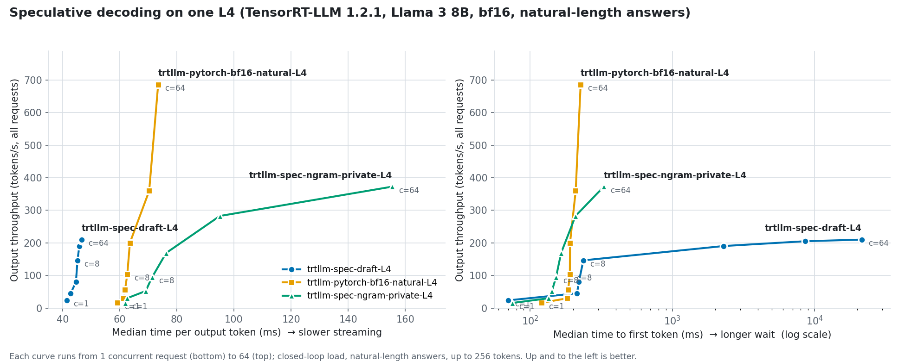
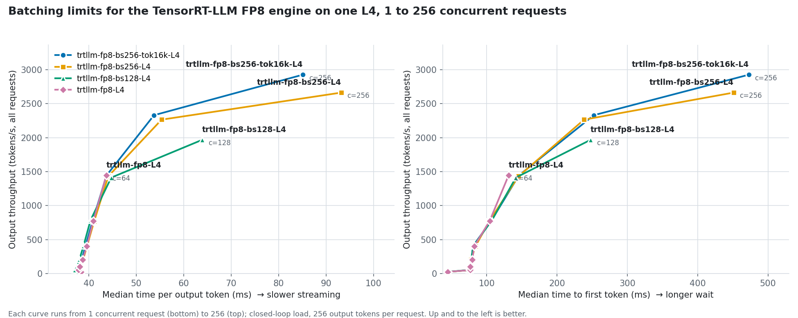

# TensorRT-LLM integration: what I built, measured, and learned

This is a working log of integrating NVIDIA TensorRT-LLM into InferEdge as a self-hosted serving backend, next to vLLM, on a single NVIDIA L4. The integration is partial and in progress: the engines build, serve, and are benchmarked, and the next steps are listed at the end.

## What is integrated

`gpu/modal_trtllm.py` runs on a cloud L4 through Modal and does four things:

1. **Downloads the model** (`NousResearch/Meta-Llama-3-8B-Instruct`, an ungated copy of Llama 3 8B Instruct) into a persistent volume.
2. **Builds TensorRT engines ahead of time.** Unlike vLLM, which loads the checkpoint and runs it, TensorRT-LLM compiles the model into an engine specialized for this exact GPU (sm_89, Ada), batch size (64), and sequence length (2,048). Engines are cached, so each build happens once.
3. **Serves the engine** with `trtllm-serve`, which exposes the same OpenAI-compatible API as vLLM and hosted NIM.
4. **Measures it** with `scripts/sweep_serving.py`, the same load generator and streaming client used for vLLM and hosted NIM, so every number in the comparison comes from the same code path.

Because `trtllm-serve` is OpenAI-compatible, the InferEdge app itself can also use it through `INFERENCE_MODE=local` (`backend/app/inference/local_engine.py`) with no other changes.

The variants measured:

| Variant | How it runs |
|---|---|
| `bf16` | Compiled TensorRT engine in the checkpoint's native precision |
| `fp8` | Compiled engine with post-training FP8 quantization of weights, activations and KV cache. NVIDIA ModelOpt runs calibration batches through the bf16 model to choose FP8 scaling factors before the build. |
| `pytorch-bf16` | TensorRT-LLM 1.x's new default backend: no engine build; the Hugging Face checkpoint is served by TensorRT-LLM's PyTorch runtime with its optimized kernels |
| `spec-draft`, `spec-ngram-private` | Speculative decoding on the PyTorch backend, against `pytorch-bf16-natural` (see below) |
| `fp8-bs128`, `fp8-bs256`, `fp8-bs256-tok16k` | The FP8 engine rebuilt with higher batching limits (see below) |

## Results

Measured on October 23, 2026 on one NVIDIA L4 (24 GB) with the same sweep as vLLM: 1 to 64 concurrent requests, closed-loop load, exactly 256 output tokens per request. "1 user" is concurrency 1; "64 users" is concurrency 64. TTFT is time to first token, and ITL p99 is the worst 1% of gaps between streamed tokens.

| Engine | Precision | 1 user: ms per token | 1 user: TTFT (ms) | 64 users: total tok/s | 64 users: TTFT p50 (ms) | 64 users: ITL p99 (ms) | KV cache (tokens) |
|---|---|---:|---:|---:|---:|---:|---:|
| TensorRT-LLM engine | FP8 (weights + KV cache) | 38.3 | 44 | 1,448 | 131 | 48 | 170,176 |
| vLLM | FP8 (weights + KV cache) | 35.8 | 53 | 1,394 | 283 | 139 | 155,936 |
| vLLM | FP8 (weights) | 35.7 | 51 | 1,332 | 298 | 150 | 81,008 |
| TensorRT-LLM engine | bf16 | 61.5 | 70 | 889 | 199 | 223 | 39,552 |
| vLLM | bf16 | 59.1 | 78 | 851 | 367 | 228 | 34,384 |
| TensorRT-LLM PyTorch backend | bf16 | 59.4 | 78 | 837 | 289 | 236 | 39,424 |

Output throughput (tokens/s, all requests) at each concurrency level:

| Concurrency | trtllm-fp8 | vllm-fp8 | trtllm-bf16 | vllm-bf16 | trtllm-pytorch-bf16 |
|---:|---:|---:|---:|---:|---:|
| 1 | 26 | 28 | 16 | 17 | 17 |
| 2 | 53 | 55 | 32 | 33 | 32 |
| 4 | 105 | 110 | 64 | 65 | 64 |
| 8 | 206 | 215 | 126 | 128 | 127 |
| 16 | 403 | 419 | 248 | 251 | 246 |
| 32 | 776 | 776 | 479 | 452 | 443 |
| 64 | 1,448 | 1,332 | 889 | 851 | 837 |


**What the numbers say:**

- **FP8 is the biggest lever, in both engines.** One user's text streams about 1.6x faster (59 → 36 ms per token in vLLM, 62 → 38 in TensorRT-LLM), and peak throughput rises 56–63%. Decoding is memory-bound: every token requires reading all the weights, so halving their size nearly halves the time per token.
- **TensorRT-LLM wins under load; vLLM wins one user at a time.** With a single user, vLLM was slightly faster per token in both precisions (by 2–3 ms). At 64 concurrent users, the TensorRT-LLM FP8 engine delivered 9% more throughput, less than half of vLLM's time to first token (131 vs 298 ms), and much steadier streaming (48 vs 150 ms worst-case gap between tokens).
- **FP8 KV cache doubles capacity, but it isn't TensorRT-LLM's latency edge.** The TensorRT-LLM FP8 engine stores its KV cache in FP8 and fit 170,176 tokens, 4.3x its bf16 engine. Turning on vLLM's FP8 KV cache (`--kv-cache-dtype fp8`) nearly doubled vLLM's cache too, from 81,008 to 155,936 tokens, but only raised throughput 5% and barely moved latency: at 64 users TensorRT-LLM still had less than half the first-token wait (131 vs 283 ms) and a third of the worst-case token gap (48 vs 139 ms). So the latency advantage comes from TensorRT-LLM's scheduler and kernels, not its cache format.
- **The compiled engine beat TensorRT-LLM's own default.** In bf16 the ahead-of-time engine reached 889 tok/s with a 199 ms first-token wait at 64 users, while the 1.x default PyTorch backend reached 837 tok/s and 289 ms, about the same as vLLM. The engine pays for that with a 3-minute build per configuration.
- **No errors** in any of the 1,000+ requests across the three variants.

### Speculative decoding

Speculative decoding lets a cheap drafter propose several tokens, which the 8B model then checks in a single forward pass. With greedy decoding the output is identical to normal decoding, so these runs use natural-length answers (about 90 tokens) against a matching baseline. All run on TensorRT-LLM's PyTorch backend, where 1.2.1 configures speculation.

| Concurrency | No speculation: ms/token | Draft model (Llama 3.2 1B): ms/token | N-gram, private pool: ms/token | No speculation: TTFT p50 (ms) | Draft model: TTFT p50 (ms) |
|---:|---:|---:|---:|---:|---:|
| 1 | 59.3 | 41.4 (1.43x) | 62.0 (0.96x) | 121 | 70 |
| 2 | 61.4 | 42.9 (1.43x) | 62.5 (0.98x) | 182 | 213 |
| 4 | 61.9 | 44.7 (1.38x) | 69.1 (0.90x) | 185 | 220 |
| 8 | 62.7 | 45.2 (1.39x) | 71.3 (0.88x) | 190 | 236 |
| 16 | 63.6 | 45.9 (1.39x) | 76.3 (0.83x) | 191 | 2,284 |
| 32 | 70.3 | 46.6 (1.51x) | 95.1 (0.74x) | 209 | 8,622 |
| 64 | 73.5 | 46.6 (1.58x) | 155.4 (0.47x) | 226 | 21,438 |



- **A draft model makes each user's text stream about 1.4x faster** (59 → 41 ms per token with one user), using `unsloth/Llama-3.2-1B-Instruct`, which shares Llama 3's 128,256-token vocabulary.
- **On a 24 GB GPU that costs capacity.** The 1B draft model and its buffers leave room for only about a third of the usual KV cache, so throughput tops out near 210 tok/s. Beyond 8 concurrent users requests queue, and the first-token wait jumps to 2.3 s at 16 users and 21 s at 64. Each token still streams fast once a request starts; the cost shows up as waiting. Draft-target is a low-traffic, latency-first tool on this GPU.
- **N-gram speculation didn't help this workload.** It drafts by copying n-grams already seen in the prompt and output. Support answers rarely repeat their question, so most drafts are rejected and the extra verification costs time: 0.96x with one user, falling to 0.47x at 64.
- **TensorRT-LLM's default n-gram pool is shared across requests**, which looked spectacular here (4.2x at 2 users) for the wrong reason. The benchmark repeats prompts and greedy decoding repeats answers word for word, so the shared pool became an answer cache. With a per-request pool (`is_public_pool: false`) the gain disappeared. I report the private-pool numbers and kept the shared-pool run in `benchmark_results/gpu/` as the cautionary example.

### Batching limits

The FP8 engine above was built for at most 64 concurrent requests and 8,192 tokens per step. Rebuilding it with higher limits and pushing to 256 concurrent requests:

| Engine limits | 64 users: tok/s | 128 users: tok/s, TTFT p95 (ms) | 256 users: tok/s, TTFT p95 (ms) | ms per token at the top level | Build (s) |
|---|---:|---:|---:|---:|---:|
| batch 64, 8k tokens/step (original) | 1,448 | — | — | 43.7 | 182 |
| batch 128, 8k | 1,413 | 1,969, 477 | — | 63.9 | 212 |
| batch 256, 8k | 1,432 | 2,266, 397 | 2,664, 1366 | 93.2 | 236 |
| batch 256, 16k | 1,445 | 2,331, 400 | 2,928, 997 | 85.1 | 204 |



- **Raising the batch cap from 64 to 256 doubled peak throughput**, to 2,928 tok/s at 256 concurrent requests, with no cost below 64 users.
- **The price is per-user speed.** At 256 users each user's text streams at about 12 tokens/s (85 ms per token) and the slowest 5% wait a second for the first token. Around 128 users is the knee: 2,331 tok/s, with first-token p95 under 0.4 s and about 19 tokens/s per user.
- **A larger per-step token budget only matters at the extreme.** 16k vs 8k tokens per step gave 10% more throughput at 256 users and cut the slow first-token wait from 1.4 to 1.0 s, because more new requests' prompts fit into one step.
- **Don't run right at the cap.** At 128 users, the engine built for 128 delivered 1,969 tok/s and the one built for 256 delivered 2,266.

## What broke, and what I learned

**1. The published recipe no longer installs.** I started from Modal's TensorRT-LLM example, which pins `tensorrt-llm==0.20.0`. That version requires exactly `xgrammar==0.1.16`, which has since been removed from PyPI, so `pip install tensorrt-llm==0.20.0` now fails for everyone. The lesson: pin the whole environment, not just the top-level package. The fix was NVIDIA's prebuilt `nvcr.io/nvidia/tensorrt-llm/release:1.2.1` container from NGC, which ships every dependency already resolved. That is NVIDIA's recommended way to run TensorRT-LLM anyway.

**2. The API moved between 0.20 and 1.x.** In 1.x, `tensorrt_llm.LLM` is the PyTorch backend. The classic build-an-engine path moved to `tensorrt_llm._tensorrt_engine.LLM`, and serving an engine needs `trtllm-serve serve <engine> --backend tensorrt`. Rather than guess, I started the container on a GPU and read `trtllm-serve serve --help` and the module layout directly.

**3. The container's library path was silently replaced.** The engine build failed with `ImportError: libnvonnxparser.so.10`, even though the file exists in the image at `/usr/local/tensorrt/lib`. An interactive shell in the same image had that directory on `LD_LIBRARY_PATH`, but processes launched from the Modal function did not: the runtime's `LD_LIBRARY_PATH` kept only the PyTorch and CUDA entries. Passing NVIDIA's full library path to the build and server processes fixed it. The lesson: when "the file is right there" but loading fails, compare the environment of the failing process, not the image.

**4. My first L4 run used the wrong CUDA image for CuPy.** (Router benchmark, same session.) CuPy compiles its reduction kernels at run time with NVRTC, which needs the CUDA headers that only the `devel` images include. With the slim `runtime` image the compile error was printed as "Exception ignored" and timing continued, producing numbers for a kernel that never ran. The benchmark now refuses to time anything until the GPU and CPU agree on every result.

**5. Calibrated FP8 was cheap to build.** FP8 post-training quantization with 64 calibration batches built in 182 seconds on the L4, about the same as the bf16 engine (192 seconds).

**6. "Fastest engine" depends on the load.** A single-request benchmark would have crowned vLLM; a throughput benchmark crowns TensorRT-LLM. For a real-time support agent, the deciding numbers are first-token wait and worst-case streaming gaps at realistic concurrency, which is why the sweep records both.

**7. TensorRT-LLM's speculative config name doesn't match its own class.** `DraftTargetDecodingConfig.decoding_type` says `"Draft_Target"`, but the YAML parser's lookup table only accepts `"DraftTarget"`. Using the class's value fails with `Invalid decoding type`. I found the real key by reading `llm_args.py` in the container.

**8. Speculation's out-of-memory error was a logits buffer, not the model.** Both speculative variants failed to allocate exactly 3.91 GiB. That is the float32 scores buffer: 8,192 tokens per step × 128,256 vocabulary × 4 bytes. Speculation scores every draft position, so the runtime reserves it up front. These prompts never need more than about 320 tokens per step, so capping the token budget at 2,048 (1,024 for draft-target, which holds a second model) fixed it without constraining anything. The lesson: when an allocation size is oddly specific, work out what it is.

**9. Draft-target crashed in TensorRT-LLM's overlap scheduler.** With memory fixed, the server served traffic and then died with `assert request.py_is_first_draft` inside `_executor_loop_overlap`. That's the scheduler that prepares the next step while the GPU runs the current one. Setting `disable_overlap_scheduler: true` made draft-target stable for the whole sweep. It looks like a 1.2.1 bug in that combination.

**10. A too-good result is a bug until proven otherwise.** The shared n-gram pool's 4.2x speedup came from the benchmark repeating prompts, not from speculation. Measuring the private-pool variant took one more run and turned a misleading headline into an accurate one.

## Next steps

- **EAGLE-style speculation.** Draft heads trained on the target model's own hidden states are far smaller than a separate 1B model, so they should keep draft-target's 1.4x per-token gain without giving up most of the KV cache. That needs Llama 3.1 for published EAGLE3 heads, or training heads for Llama 3.
- **Speculation on the FP8 engine.** Combining the 36–38 ms FP8 decode with drafting is the next latency step for one user.
- **Chunked prefill** on the batch-256 engine, to flatten first-token latency past the 128-user knee.
- **Triton Inference Server or NVIDIA Dynamo** in front of the engines, for production batching policies and KV-cache-aware routing across replicas, which is the production version of InferEdge's semantic router.

## Reproduce

```bash
modal run gpu/modal_trtllm.py --variants bf16,fp8,pytorch-bf16
modal run gpu/modal_trtllm.py --variants pytorch-bf16-natural,spec-draft,spec-ngram-private
modal run gpu/modal_trtllm.py --variants fp8-bs128,fp8-bs256,fp8-bs256-tok16k
backend/.venv/bin/python scripts/plot_sweep.py benchmark_results/gpu/sweep_*-L4.json
```

See [SELF_HOSTED.md](SELF_HOSTED.md) for setup.
